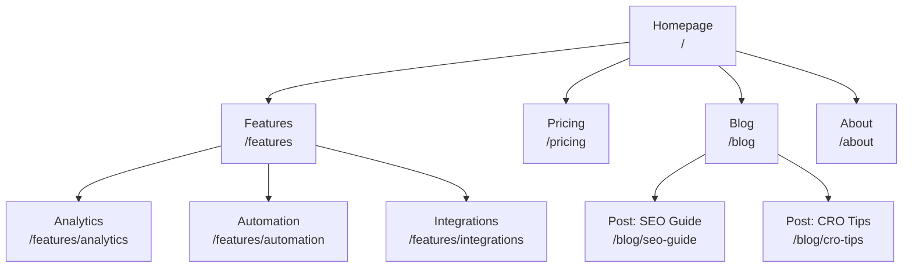
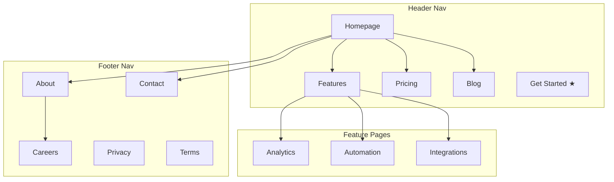
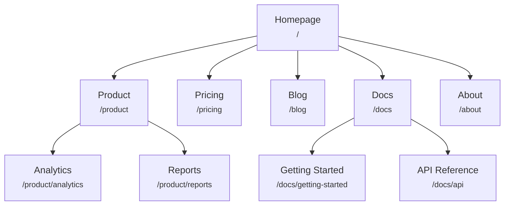
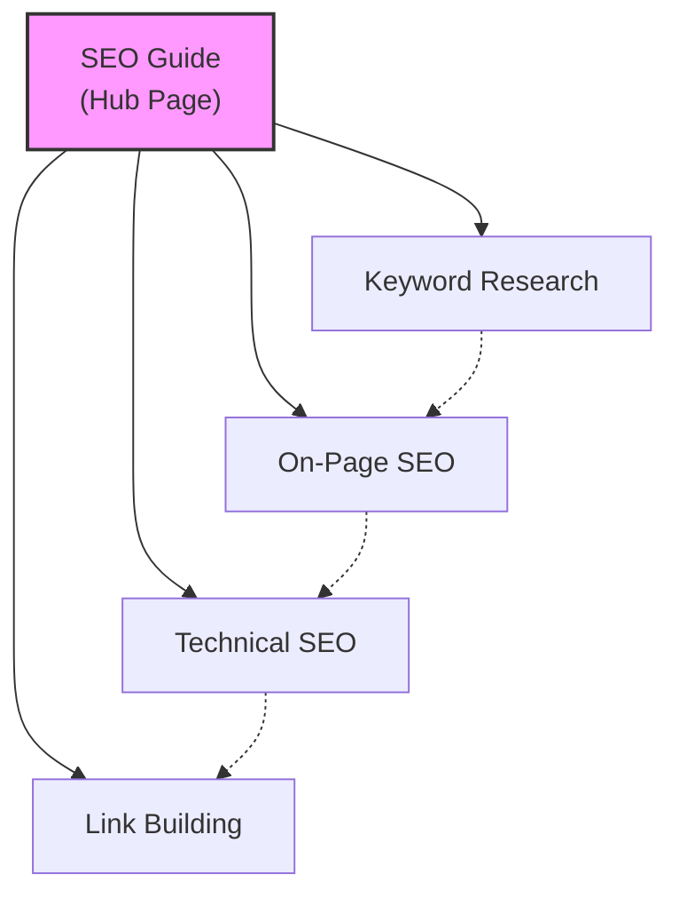
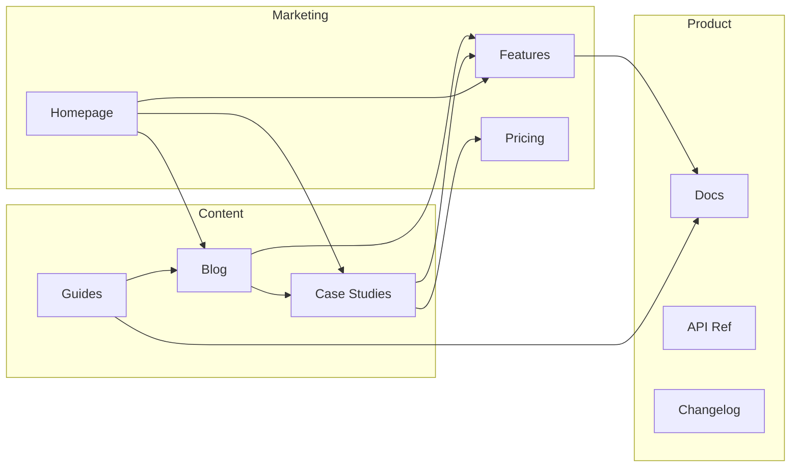
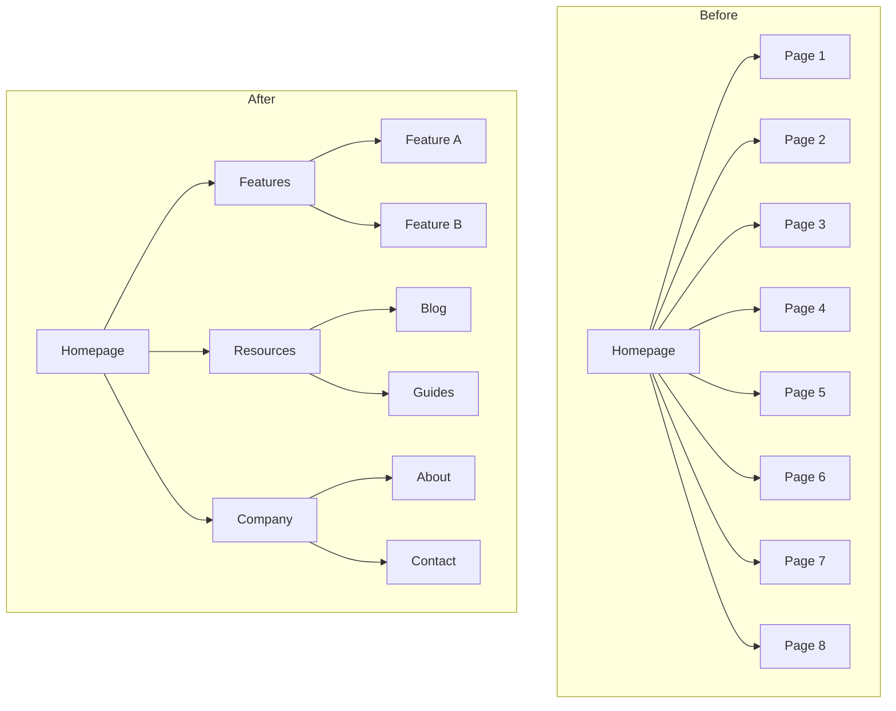
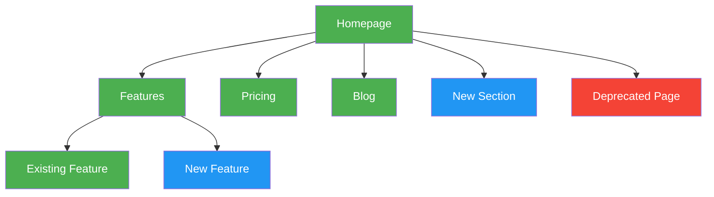

# Page trees and sitemap diagrams

Two formats for showing a site's structure, copied from coreyhaines31/marketingskills' `site-architecture` (MIT, SKILL.md and references/mermaid-templates.md): an ASCII tree for quick drafts and text-only contexts, and Mermaid diagrams for presentations, complex relationships, navigation zones and linking patterns. These are visual sitemaps for people; the XML sitemap search engines read is in [seo TECHNICAL-AUDIT.md](https://github.com/Quegenx/agent-skills/blob/main/skills/marketing/seo/TECHNICAL-AUDIT.md).

**Contents:** [ASCII tree](#ascii-tree) · [Basic Hierarchy](#basic-hierarchy) · [Hierarchy with Navigation Zones](#hierarchy-with-navigation-zones) · [Hierarchy with URL Labels](#hierarchy-with-url-labels) · [Hub-and-Spoke Content Model](#hub-and-spoke-content-model) · [Internal Linking Flow](#internal-linking-flow) · [Before/After Restructuring](#beforeafter-restructuring) · [Color-Coding Conventions](#color-coding-conventions) · [Prove it](#prove-it)

## ASCII tree

The page hierarchy deliverable, with the URL at every node [coreyhaines31/marketingskills, site-architecture]:

```
Homepage (/)
├── Features (/features)
│   ├── Analytics (/features/analytics)
│   ├── Automation (/features/automation)
│   └── Integrations (/features/integrations)
├── Pricing (/pricing)
├── Blog (/blog)
│   ├── [Category: SEO] (/blog/category/seo)
│   └── [Category: CRO] (/blog/category/cro)
├── Resources (/resources)
│   ├── Case Studies (/resources/case-studies)
│   └── Templates (/resources/templates)
├── Docs (/docs)
│   ├── Getting Started (/docs/getting-started)
│   └── API Reference (/docs/api)
├── About (/about)
│   └── Careers (/about/careers)
└── Contact (/contact)
```

## Mermaid templates

Copy-paste-ready diagrams; customize node labels and connections for the site. Use `graph TD` for hierarchies, with subgraphs for navigation zones where they help [coreyhaines31/marketingskills, site-architecture].

## Basic Hierarchy

Simple top-down page hierarchy.



---

## Hierarchy with Navigation Zones

Uses subgraphs to show which pages appear in which navigation area.



---

## Hierarchy with URL Labels

Each node shows the page name and URL path.



---

## Hub-and-Spoke Content Model

Shows a hub page connected to spoke articles, with spokes linking to each other.



Legend:
- Solid lines = primary hub-spoke links
- Dashed lines = cross-links between spokes

---

## Internal Linking Flow

Shows how different site sections link to each other.



---

## Before/After Restructuring

Compare current and proposed site structures side by side.



---

## Color-Coding Conventions

Use styles to highlight page status, priority, or type.



Color key:
- **Green** (`#4CAF50`): Existing pages (no changes)
- **Blue** (`#2196F3`): New pages to create
- **Red** (`#f44336`): Pages to remove or redirect
- **Yellow** (`#FFC107`): Pages to restructure or move
- **Purple** (`#9C27B0`): High-priority / CTA pages

---

## Prove it

The ASCII tree and the Mermaid diagram show the same pages and URLs as the URL map; each diagram renders in a Mermaid viewer without a syntax error; a restructure diagram uses the colour key and its legend; and every red (remove or redirect) node has a row in the redirect map ([PLATFORMS-AND-MIGRATION.md](PLATFORMS-AND-MIGRATION.md#migrating-without-losing-traffic)).
